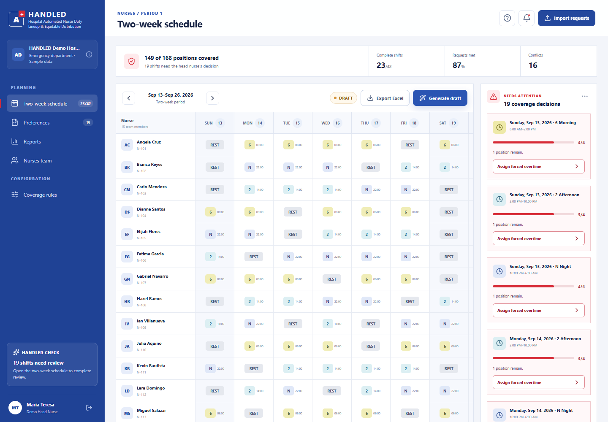
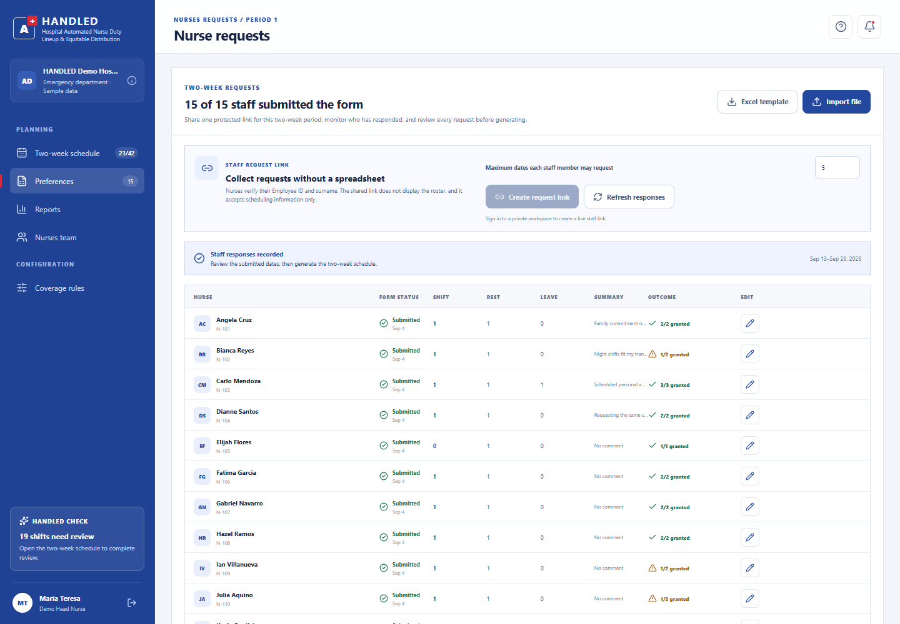
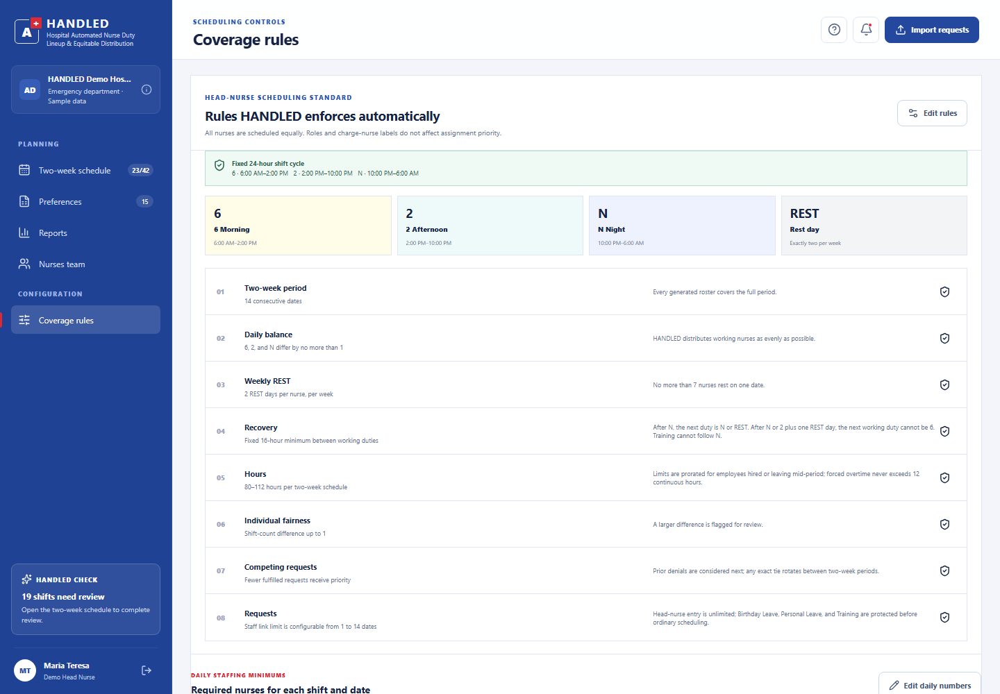
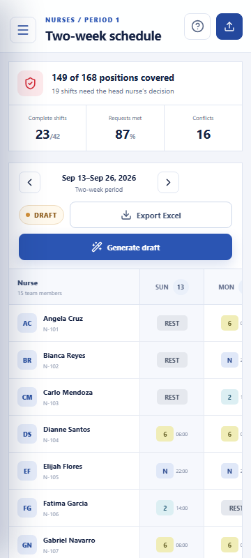
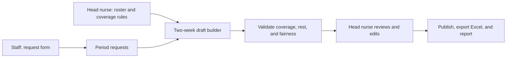

# HANDLED — Hospital Automated Nurse Duty Lineup & Equitable Distribution

**Your ED Schedule, Automatically.** HANDLED is a deployable scheduling website for an ER head nurse. It turns structured staff requests into a balanced two-week draft, explains any rules it cannot satisfy, supports employee lifecycle and understaffing decisions, and exports a print-ready Excel schedule.

Live Vercel application: [ace-er-scheduling.vercel.app](https://ace-er-scheduling.vercel.app/)

## Screenshots and walkthroughs

| Two-week schedule | Staff requests |
| --- | --- |
|  |  |

| Coverage rules | Mobile schedule |
| --- | --- |
|  |  |

More screens: [Nurses team](docs/screenshots/team-desktop.png).

Videos: [44-second client demo](docs/videos/client-demo.mp4) · [desktop walkthrough](docs/videos/desktop-tour.mp4) · [mobile walkthrough](docs/videos/mobile-tour.mp4). The client demo follows one workflow (staff requests → generated draft → 19 coverage decisions → published two-week schedule) captured from the running app. On-screen captions carry the story with the sound off, and the music is an original synthesized score. All captures use synthetic demo data.

## How it works



See the [full workflow and system diagram](docs/architecture.md) for the API and data flow.

The shared demo contains synthetic nurses and requests. The `acesalazar` client account starts with an empty workspace. A separate authenticated test account is pre-populated. Each private account may create multiple isolated Nurses or Orderlies workspaces; every workspace persists its own roster, requests, schedules, staffing rules, overtime coverage, and publication state in Neon Postgres.

## Current scheduling model

- Covers 14 consecutive dates per planning period.
- Uses one duty per employee per date: `6` (06:00–14:00), `2` (14:00–22:00), `N` (22:00–06:00), `REST`, `Birthday Leave`, `Personal Leave`, or `Training`.
- Treats all nurses equally; role-based assignments are not used.
- Keeps daily `6`, `2`, and `N` totals equal when possible and within one nurse otherwise.
- Gives every nurse exactly two REST days in each seven-day half, with no more than seven nurses resting on one date.
- Always enforces at least 16 hours between working duties. After `N`, the next working duty is `N` unless separated by REST; after `N` or `2` plus one REST day, the next working duty cannot be `6`.
- Plots Birthday Leave and Personal Leave first, Training second, then REST and working shifts. Training is non-working, does not count as weekly REST, and cannot follow `N`.
- Balances each nurse’s `6`, `2`, and `N` assignments as evenly as possible.
- Gives staff a configurable request allowance of 1–14 dates through the shared form; head-nurse entry is unlimited. Shift and REST requests are preferences, while both leave types and Training are protected.
- Resolves competing requests by prioritizing fewer fulfilled requests in the current period, then prior denials, then fewer historical grants, with a rotating tie-breaker between periods.
- Lists any unsatisfied balance, REST, recovery, fairness, or mandatory-leave rule for head-nurse review.
- Lets the head nurse set minimum and maximum hours per two-week schedule; limits are prorated for employees hired or leaving during the period.
- Uses per-date minimum staffing values for each `6`, `2`, and `N` shift.

## Product features

- Automatic two-week schedule generation and direct editing of every nurse/date cell.
- Structured 14-day head-nurse request editor with `No request`, `6`, `2`, `N`, `REST`, `Birthday Leave`, `Personal Leave`, and `Training`; the staff-facing form excludes Training.
- Multiple isolated Nurses or Orderlies workspaces under one head-nurse account, with create, switch, rename, and delete controls.
- Per-request schedule outcomes with a specific reason when a request cannot be granted.
- A revocable two-week staff-request link with a configurable 1–14 date allowance and per-nurse submission status.
- Optional reuse of the previous period’s requests without copying its schedule.
- Employee records with editable Employee ID, first name, surname, date hired, and optional last working date.
- Optional staff request summaries, limited to 500 characters and visible to the head nurse.
- Forced understaffing coverage by converting adjacent eight-hour duties into two 12-hour shifts. If `2 Afternoon` cannot be filled, matched `6 Morning` and `N Night` employees work `06:00–18:00` and `18:00–06:00`; each receives four overtime hours. Selection balances prior overtime first and uses the newest hire as the tie-breaker.
- Privacy-focused Vercel Web Analytics for aggregate page views only. All URL query parameters are removed before collection, and no custom events contain Employee IDs, names, requests, or schedule data.
- Clear understaffed and unbalanced markers when coverage cannot be resolved safely.
- Daily summary rows for `6`, `2`, `N`, `REST`, and leave.
- Formatted Excel request template and color-coded, print-ready schedule export.
- Monthly and yearly reports across generated two-week periods.
- An opt-in 11-step tutorial that spotlights the exact controls being explained.
- Responsive layouts, keyboard navigation, visible focus, reduced-motion support, and accessible labels.

## Authentication and data handling

- There is no public sign-up flow.
- Authentication is server validated; sessions use signed, secure, HTTP-only, SameSite-Strict cookies.
- Passwords are stored as salted scrypt hashes in server-only environment variables, never in browser code.
- Workspace writes are same-origin checked, validated on the server, tied to the authenticated account, and logged with non-identifying audit metadata.
- Staff links are signed, period-scoped, and revocable. The public form never exposes the roster and requires a matching Employee ID and surname before accepting a response.
- Security headers include a restrictive Content Security Policy, HSTS, frame blocking, and a restrictive Permissions Policy.
- Patient data must never be entered. The current fixed-account model is for a controlled pilot, not a hospital-wide rollout.

Before real hospital use, the deploying hospital still needs managed identities with MFA, durable shared rate limiting, password recovery, access reviews, backup/restore testing, an approved retention policy, incident response, and privacy/DPO review.

## Run locally

Prerequisites: Node.js 20 or newer and npm.

```powershell
npm install
npm run dev
```

Open `http://127.0.0.1:5173`. In Vite development mode, `demo` / `DEMO` is available for UI testing. To exercise the real API locally, configure the server-only variables below and run `npx vercel dev`.

```text
ACE_HEAD_USERNAME
ACE_HEAD_PASSWORD_HASH
ACE_DEMO_PASSWORD_HASH
ACE_TEST_USERNAME
ACE_TEST_PASSWORD_HASH
ACE_SESSION_SECRET
DATABASE_URL
```

The `ACE_*` variable names are retained only as deployment configuration keys for backward compatibility with the existing Vercel project. Never put a real password or database credential in a `VITE_` variable.

## Request workbook format

Use one row per nurse. The first two columns are `Employee ID` and `Nurse name`; the next 14 columns are the dated schedule period. Each date is blank or contains exactly one of:

```text
6 Morning
2 Afternoon
N Night
REST
Birthday Leave
Personal Leave
Training
```

HANDLED accepts `.xlsx` and `.csv` files up to 5 MB. Employee IDs must match the active roster. The shared staff form enforces the head nurse’s configured 1–14 date allowance; direct head-nurse entry and import are not limited to five dates.

## Verify and deploy

```powershell
npm run lint
npm test -- --run
npm run build
npm run qa:responsive
npx vercel@latest deploy --prod --yes --project ace-er-scheduling
```

The responsive QA command captures exact 360 px, 768 px, and 1440 px browser viewports using the project’s Windows Chrome path.

## Pilot boundaries

- HANDLED is scheduling decision support, not clinical software, payroll, timekeeping, or a replacement for hospital staffing policy.
- Demo and test workspaces contain synthetic information only.
- Request files are parsed in the browser; normalized workspace data is then saved through the authenticated API.
- The staff request link is lightweight self-service, not strong identity authentication: a shared link plus Employee ID and surname should only be used in a controlled pilot. Notifications, direct Google Sheets synchronization, MFA, and hospital identity-provider integration are not implemented.

See [the build plan](docs/BUILD_PLAN.md) for remaining pilot-readiness work.
