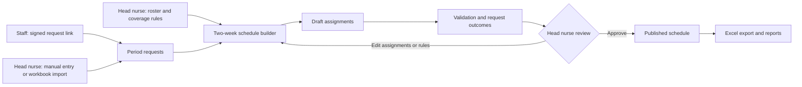
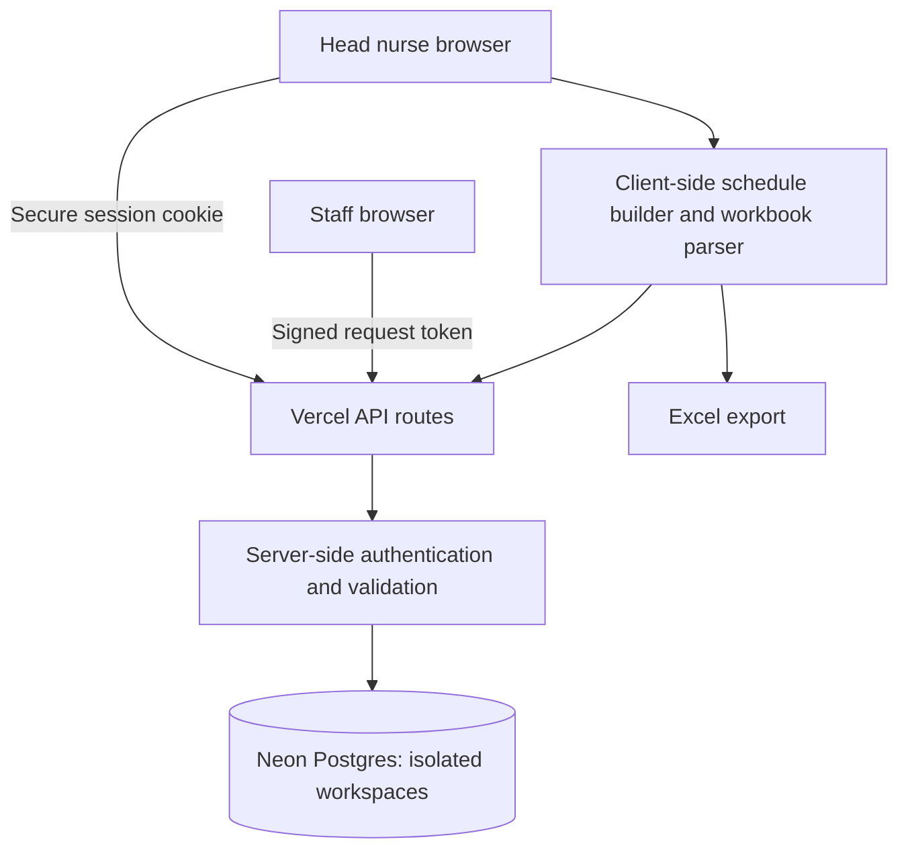

# How HANDLED works

HANDLED turns a two-week staffing plan into a reviewable draft. The head nurse remains responsible for approving and publishing the schedule.

## Data flow

1. An authenticated head nurse selects a Nurses or Orderlies workspace and maintains its roster and daily shift coverage rules.
2. Staff submit requests through a period-scoped, revocable link after matching their Employee ID and surname. The head nurse can also enter requests or import a workbook.
3. The browser builds a 14-day draft using the roster, requests, coverage minimums, work-hour limits, rest and recovery rules, and request fairness history.
4. Validation surfaces unfilled shifts, unsatisfied requests, and rule conflicts. The head nurse may edit cells, adjust rules, and assign supported overtime coverage.
5. The approved schedule can be published, exported to Excel, and summarized in reports. Workspace state is saved through authenticated API routes in Neon Postgres.

## Application boundaries

The demo uses synthetic staff data. The fixed-account authentication model and staff link verification are pilot controls; see the [README](../README.md#pilot-boundaries) before considering real hospital use.
